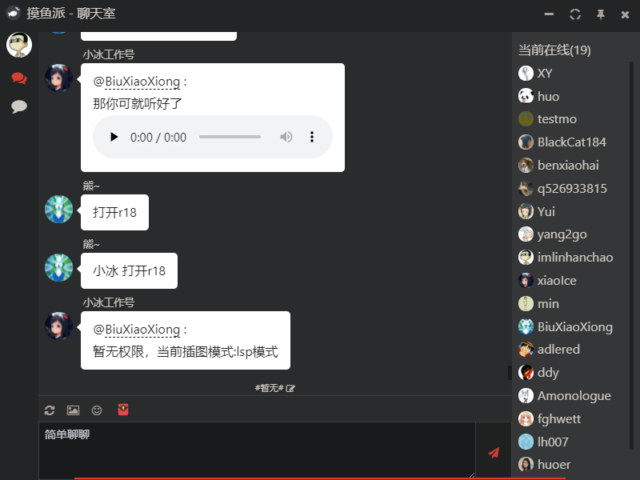

<p align="center">
  <a href="https://fishpi.cn">
    
  </a>
</p>

<h1 align="center">摸鱼派桌面</h1>

基于摸鱼打工人社区——[摸鱼派](https://fishpi.cn)开放 API 开发而成，可以在里面愉快的吹水摸鱼。

本仓库是 [fishpi-desktop](https://github.com/FishPiOffical/fishpi-desktop) 的 Tauri 重构。后端由 [fishpi-rust](https://github.com/FishPiOffical/fishpi-rust) 提供。

感谢 [午安宝贝](https://github.com/KwdeTfpv) 提供的 [fishpi-rust](https://github.com/FishPiOffical/fishpi-rust)，以及 [跳佬](https://github.com/imlinhanchao) 的旧版 [fishpi-desktop](https://github.com/FishPiOffical/fishpi-desktop)。

## ✨ 功能

- 😎 聊天室吹水；
- 💬 单人私聊；
- 📷 大图查看；
- 👉 @ 列表选择；
- 🍃 清风明月；
- 🎶 网易云音乐播放列表；
- 📰 社区看帖评论；
- ⚙️ 丰富的自定义设置功能；
- 🎨 自定义主题；

## 🗺️ 里程碑

2026-10-09 起以旧版源码的实际功能和交互为迁移基准，不再使用未经逐项验收的完成百分比。SDK 固定为 crates.io `fishpi-sdk = "=1.1.1"`，不用本地 path。当前完成一轮按模块实现及自动化检查，真实账号与 Windows 桌面验收尚未完成，不能认定“全部迁完”。

- [x] **登录与基础层**：原生系统凭据库、登录页显式导入旧配置、账号隔离缓存、真实 SDK 重连和同会话校验
- [x] **聊天室**：核对收发、历史、撤回、回复/复读、话题、弹幕、表情/@、图片、特殊卡片与用户菜单
- [x] **私聊与红包**：核对未读/已读、换会话竞态、历史/实时合并、输入、五类红包、再发一个和真实领取状态
- [x] **内容**：核对帖子/评论操作、评论倒序翻页、实时评论、付费正文边界、清风明月列表与发送
- [x] **桌面与设置**：核对原设置默认值、通知类别、音乐策略、托盘/老板键/窗口、名片与看图
- [x] **扩展与旧配置**：核对元信息/README、受控主题颜色、旧设置/屏蔽/特别关心导入
- [ ] **统一人工验收**：按 [迁移与验收清单](docs/migration/README.md) 逐模块测试
- [ ] **已知不等价项**：见下方，不计作已迁移

### 相对旧版还没做完

**SDK / 平台受限**（已禁用或降级，不假装成功）

- 签到写入：当前 SDK 只有 `is_checkin` 查询
- 云端表情收藏和名片 MBTI 已通过 Rust 固定接口补迁，仍需真实账号验收，未使用服务器分组替代收藏
- 弹幕无服务端 oId（客户端已用时间戳 + 序号避免同文去重，仍不能当撤回 ID）
- 运行中掉线无公开回调，不会把「暂时没消息」当成离线
- 系统通知点击无法跳到对应页（`tauri-plugin-notification` 2.4 在 Windows 上没有点击回调）
- 网易云专辑不伪造可播地址
- 旧扩展侧栏/webview、command/hooks 的 Electron 任意 JS 执行未兼容；当前是只读元信息和 README
- 旧主题只映射支持的颜色变量，不执行整份布局 CSS，不承诺第三方主题像素一致
- 看图/@/红包继续使用主窗 overlay，未全部恢复旧独立窗口形态

**安全边界**

- 当前没有兼容旧 Electron JS 插件运行时；不保存明文密码，不自动执行下载的安装包

## 🛡 编译运行

需要本机已安装 [Node.js](https://nodejs.org/) 与 [Rust](https://www.rust-lang.org/)。

``` bash
# 安装依赖
pnpm install

# 开发运行，前端挂靠在 localhost:1420
pnpm tauri dev

# 编译生成桌面应用
pnpm tauri build

# 模块逻辑与 IPC 契约测试
pnpm test

# Rust 测试（在 src-tauri 目录执行）
cargo test --locked --offline --lib

```

## 👀 界面


